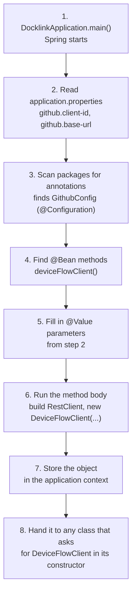

# Configuration and Beans

> [!summary] In one sentence
> A **bean** is an object Spring creates once when the app starts, stores, and hands to every class that asks for it. A **`@Configuration`** class holds the `@Bean` methods that tell Spring how to create them.

## The words

| Word | What it means |
|---|---|
| **Bean** | An object created by Spring at the start of the application, then stored and reused |
| **`@Configuration`** | Put on a class: "this class has methods that create beans" |
| **`@Bean`** | Put on a method: "run this once at startup and keep what it returns" |
| **`@Value("${...}")`** | Put on a parameter: "fill this in with a value from `application.properties`" |
| **Application context** | The place where Spring keeps all the beans |

Every time a class needs a specific bean, Spring gives it **the same object**. Everyone shares one. This is called a *singleton*, and it's the default.

> [!warning] Correction (added by Claude)
> `@Configuration` doesn't make the *class* run. Spring reads the class at startup and **runs its `@Bean` methods**. The objects those methods return become the beans.

## What happens when the app starts



> [!important] Properties are read first
> `@Value` is a lookup in what was read in step 2. If the name doesn't match `application.properties` exactly, startup stops at step 5 with *"Could not resolve placeholder"*.

## `@Component` vs `@Bean`

| | **`@Component`** | **`@Bean`** |
|---|---|---|
| Put on | The class itself | A method in a `@Configuration` class |
| Who calls `new` | Spring, automatically | You, inside the method |
| Use when | The constructor only needs other beans | Creating the object needs extra setup (values from properties, a configured `RestClient`) |

## In Docklink

```java
@Configuration
public class GithubConfig {

    @Bean
    public DeviceFlowClient deviceFlowClient(@Value("${github.client-id}") String clientId,
            @Value("${github.base-url}") String baseUrl) {
        RestClient restClient = RestClient.builder().baseUrl(baseUrl).build();
        return new DeviceFlowClient(restClient, clientId);
    }
}
```

| | **Test** | **Real app** |
|---|---|---|
| Who creates `DeviceFlowClient` | The test, with `new` | Spring, through `GithubConfig` |
| Base URL | `https://github.test` (fake) | `https://github.com` (from properties) |
| Client ID | `"test-client-id"` | The real one (from properties) |

## Naming a bean method

The naming convention is to give the method the same name as the class it returns, but with a **small letter** first: the class is `DeviceFlowClient`, the method is `deviceFlowClient`. Java treats upper and lower case as different names.

> [!note] Why that name
> The **method name becomes the bean's name**. It's the same name Spring would give automatically with `@Component`. It's a convention, not a rule: `githubLoginClient()` would work too.

## Several beans of the same class

Each `@Bean` method returns **one** object. If you want two, you need two methods with `@Bean`, each with its own name.

```java
@Bean RestClient githubRestClient() { ... }   // api.github.com
@Bean RestClient gitlabRestClient() { ... }   // gitlab.com
```

If a class then asks for "a `RestClient`" without saying which one, Spring **stops when the app starts** with *"expected single matching bean but found 2"*. You tell them apart with:
- **`@Qualifier("githubRestClient")`** on the parameter: choose exactly which one you mean
- **`@Primary`** on one of the `@Bean` methods: the default to use if nobody says otherwise

> [!warning] Correction (added by Claude)
> Having two beans of the same type is fine on its own. The error only happens when a class asks for that type **without saying which one**. It happens at startup, not later while the app is running.

> [!tip] In Docklink
> In #12 you'll call `api.github.com`, a different base URL from `github.com`. That may be the first time you need two `RestClient`s.

## Related
- [[Dependency Injection]]
- [[RestClient and MockRestServiceServer]]
- [[Importance of using final class]]
