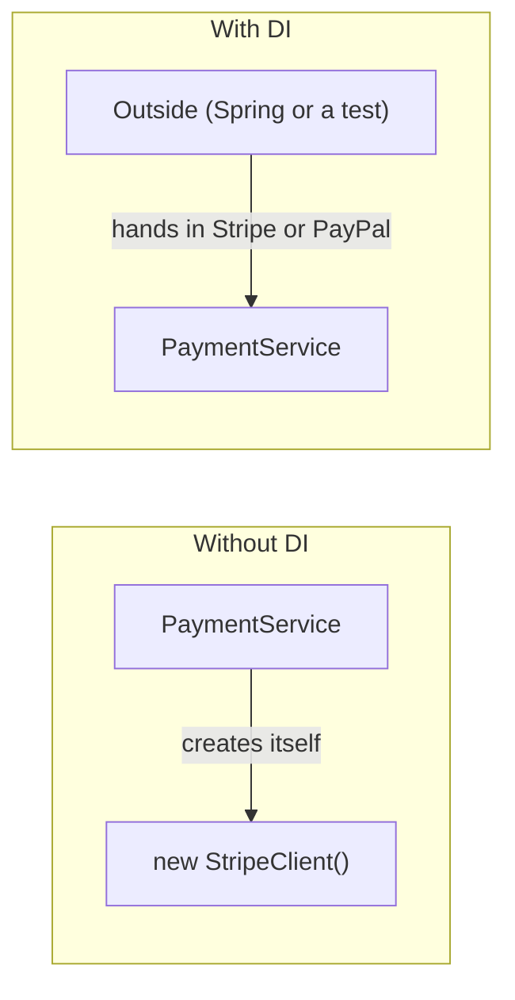

# Dependency Injection

> [!summary] In one sentence
> A class gets the things it needs (its **dependencies**) **from the outside** instead of creating them itself, so you can swap them without changing the class.

## The idea

Dependency injection is used a lot in Java. A class has **one way in** for what it needs (the straw in the box). Whatever you feed through that way in, the class handles it.

> [!example] The juice blender
> The class is a juice blender. Dependency injection is the opening where the ingredients are poured in.
> - The blender doesn't care if it's bananas, apples or oranges. It does the same work.
> - A machine built *only* for bananas has to be rebuilt the moment you switch to oranges.
>
> With one simple opening you can feed it anything, and the machine itself carries on as usual. That gives you a stable structure.

## Without and with DI

| | **Without DI** | **With DI** |
|---|---|---|
| Who creates the dependency? | The class itself, inside | Someone outside, who hands it in |
| Switching it | Change the class | Hand in something else |
| Testing | Hard: the real thing is built in | Easy: hand in a fake |



## Real-life examples

> [!example] Payments
> A system that manages payments uses Stripe. One day you decide: "No, I want PayPal instead." Through dependency injection you switch what goes in, but the payment class doesn't change. Only the dependency changes, so your code doesn't break every time you change something.

> [!example] Notifications
> Your app sends notifications, and you decide to add SMS too. You add it on top without rewriting the class that sends them.

> [!warning] Correction (added by Claude)
> "The code doesn't change" means **the class that uses the dependency** doesn't change. Some code still changes:
> - You write a **new class** for PayPal or SMS.
> - Both options must follow the same **interface** (for example `PaymentProvider`). The interface is the opening in the blender: it decides what shape the ingredients must have.
> - Something must decide **which one** to hand in: Spring's configuration, or the code that creates the class.

## How it is done in Java

The most common way is **constructor injection**: the dependency is a constructor parameter, stored in a `final` field.

```java
public class DeviceFlowClient {
    private final RestClient restClient;

    public DeviceFlowClient(RestClient restClient, String clientId) {
        this.restClient = restClient;   // handed in from the outside
        // ...
    }
}
```

In a Spring app, the **Spring container** works out what each class needs and hands it in automatically when the app starts.

> [!tip] In Docklink
> `DeviceFlowClient` gets its `RestClient` through the constructor. That's why the test can hand it a `RestClient` that talks to a fake GitHub, while the app hands it one that talks to the real GitHub. Same class, different dependency.

> [!tip] Memory trick
> Don't build what you need, **ask for it** in the constructor.

## Related
- [[RestClient and MockRestServiceServer]]
- [[Importance of using final class]]
