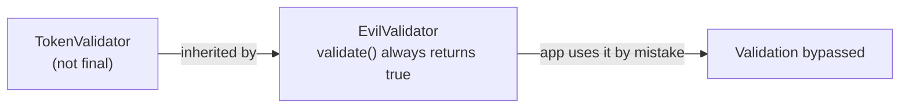

# Importance of using final class

> [!summary] In one sentence
> Marking a class `final` stops anyone from inheriting it, so nobody can override its core methods and bypass things like token validation.

## Why it matters for security

A class that is **not** `final` can be inherited. A subclass can then override some of the parent's core methods.

| | **Not `final`** | **`final`** |
|---|---|---|
| Can be inherited? | Yes | No |
| Can core methods be overridden? | Yes | No |
| Risk | Someone replaces the logic with their own | The logic can't be replaced through inheritance |

## The attack, step by step

> [!example] API token validation
> You have a class with a method that validates API tokens. If the class is not `final`:
> 1. Someone takes your class and inherits from it.
> 2. They override the validation method so it always returns `true`.
> 3. They trick the application into using their version instead of yours.
> 4. The validation is bypassed.



> [!success] The fix
> Declare the class `final`. It can't be inherited, so the code is non-overridable.

```java
public final class TokenValidator {
    public boolean validate(String token) {
        // real validation logic
    }
}
```

> [!warning] Correction (added by Claude)
> Step 3 is the weak point of the attack. If someone can already make your application load and use *their* class, they can run any code they want, so `final` alone does not stop them. What `final` really protects against:
> - **Mistakes inside your own code base**: nobody (you included) can subclass the class and accidentally change how it works.
> - **Breaking a guarantee**: if the class promises something (for example "a token is always checked"), a subclass can't quietly break that promise. This is why Java's `String` is `final`.
>
> So think of `final` as protecting **the design**, not as a lock against attackers.

> [!tip] In Docklink
> Java **records** (like `DeviceCodeResponse` and `AccessTokenResponse`) are automatically `final`. You don't have to write it.

> [!tip] Memory trick
> `final` class = a sealed box. Nobody can open it up and swap the contents by extending it.

## `final` on a field (added by Claude, 2026-11-17)

`final` means something different depending on where you put it:

| Put on | Means |
|---|---|
| A **class** | Nobody can inherit from it |
| A **field** | It gets its value once, in the constructor, and can never be changed after that |

```java
public class DeviceFlowClient {
    private final RestClient restClient;

    public DeviceFlowClient(RestClient restClient, String clientId) {
        this.restClient = restClient;   // ✅ set once, in the constructor
    }

    void something() {
        this.restClient = null;         // ❌ compile error
    }
}
```

Java checks two things for a `final` field, and won't compile otherwise:
1. It **must** be set in the constructor, so it can't be forgotten and left `null`.
2. It **can't** be changed later by any method.

> [!note] It locks the field, not the object
> `final` locks **which object** the field points to. You can still call methods on that object: `restClient.post()` is fine, `restClient = other` is not.

> [!tip] In Docklink
> Fields that come in through the constructor (dependency injection) are almost always `private final` in Spring code. `DeviceFlowClient` should use the same `RestClient` and Client ID for its whole life.

## Related
- [[Dependency Injection]]
- [[Configuration and Beans]]
