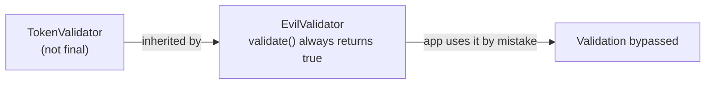

# Importance of using final class

> [!summary] In one sentence
> Marking a class `final` stops anyone from inheriting it, so nobody can override its core methods and bypass things like token validation.

## Why it matters for security

A class that is **not** `final` can be inherited. A subclass can then override some of the parent's core methods.

| | **Not `final`** | **`final`** |
|---|---|---|
| Can be inherited? | Yes | No |
| Can core methods be overridden? | Yes | No |
| Risk | Someone replaces the logic with their own | The logic can't be replaced through inheritance |

## The attack, step by step

> [!example] API token validation
> You have a class with a method that validates API tokens. If the class is not `final`:
> 1. Someone takes your class and inherits from it.
> 2. They override the validation method so it always returns `true`.
> 3. They trick the application into using their version instead of yours.
> 4. The validation is bypassed.



> [!success] The fix
> Declare the class `final`. It can't be inherited, so the code is non-overridable.

```java
public final class TokenValidator {
    public boolean validate(String token) {
        // real validation logic
    }
}
```

> [!tip] Memory trick
> `final` class = a sealed box. Nobody can open it up and swap the contents by extending it.

## Related
- (no closely related notes in this folder yet)
