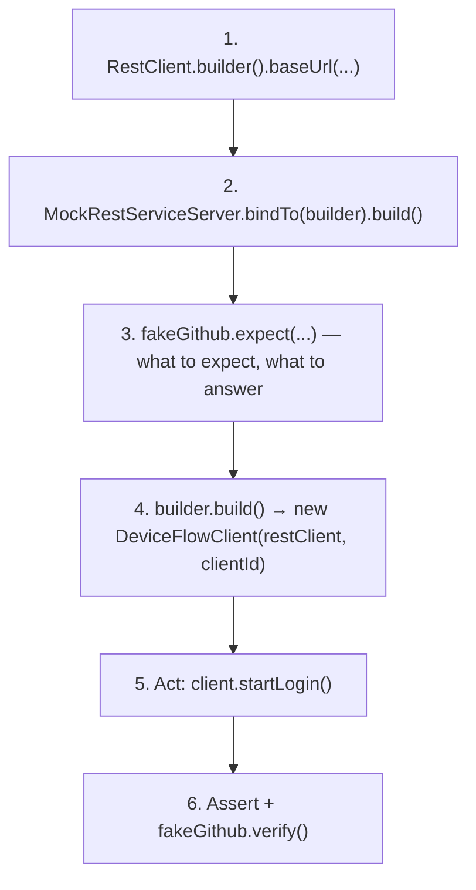

# RestClient and MockRestServiceServer

> [!summary] In one sentence
> **`RestClient`** is what lets a class make HTTP calls. **`MockRestServiceServer`** is a fake HTTP server you plug into it in tests, so no request ever reaches the real internet.

## Why test first

The test is written before the real class. That way no real API calls are made while you build, so nothing is charged and nothing on the real server can be damaged.

> [!warning] Correction (added by Claude)
> Writing the test first is **our workflow's choice** for hard areas like external services (WORKFLOW.md rule 14). It is not something `RestClient` requires. The real reason the mock server protects you is that requests go to it instead of the internet, whether the test was written first or not.

## The two parts

| | **`RestClient`** | **`MockRestServiceServer`** |
|---|---|---|
| What it is | The HTTP client your class uses | A fake HTTP server, only for tests |
| Built from | `RestClient.builder()` | `MockRestServiceServer.bindTo(builder)` |
| Knows the base URL? | Yes, `.baseUrl(...)` | **No** |

## The order, step by step



### 1. Create the builder with a base URL
```java
RestClient.Builder builder = RestClient.builder().baseUrl("https://github.test");
```
This is only a **builder**, not the client yet. The base URL says that every call goes to `https://github.test`, and each path (like `/login/device/code`) is appended to it.

### 2. Bind the fake server to the builder
```java
MockRestServiceServer fakeGithub = MockRestServiceServer.bindTo(builder).build();
```
From now on, every HTTP call from a `RestClient` built from this builder goes straight to the fake server.

> [!important] Build the client *after* binding
> The client must be built (`builder.build()`) **after** `bindTo`. A client built before the binding sends its calls to the real internet.

### 3. Tell the fake server what to expect and what to answer
```java
fakeGithub.expect(requestTo("https://github.test/login/device/code"))
        .andExpect(method(HttpMethod.POST))
        .andRespond(withSuccess("""
                {"device_code":"secret-device-code", "user_code":"ABCD-1234", ...}
                """, MediaType.APPLICATION_JSON));
```
- `requestTo(...)`: the **full** URL it should receive.
- `andExpect(method(HttpMethod.POST))`: it should be a POST request.
- `andRespond(withSuccess(...))`: answer with HTTP status **200**, with a JSON object written as a string.
- `MediaType.APPLICATION_JSON`: tells Java the answer is JSON. That matters because **Jackson** then converts the JSON into Java objects (here a `DeviceCodeResponse`).

> [!warning] Write the full URL in `requestTo`
> The base URL belongs **only** to the `RestClient`. The fake server never gets it. So you can't write just the path in `requestTo` and expect it to be joined with the base URL. Write the whole URL.

### 4. Build the client and hand it to your class
```java
DeviceFlowClient client = new DeviceFlowClient(builder.build(), "test-client-id");
```
Now the builder becomes a real `RestClient`. It's passed **inside the parentheses** (the constructor's arguments), together with a fake client ID.

> [!note] Real class, fake server
> `DeviceFlowClient` is the **real** class, the same one the app uses. Only the server it talks to is fake. That's possible because the class gets its `RestClient` from the outside: [[Dependency Injection]].

### 5–6. Run it and check
```java
DeviceCodeResponse response = client.startLogin();   // Act
assertEquals("ABCD-1234", response.userCode());      // Assert
fakeGithub.verify();
```
`verify()` checks that the fake server **actually received** every request it was told to expect. Without it, the test could pass even if no request was ever sent.

> [!tip] Memory trick
> **Bind, expect, build.** Bind the fake server to the builder, tell it what to expect, and only then build the client.

## Related
- [[Dependency Injection]]
- [[URI and URL]]
- [[Synchronous and asynchronous REST clients]]
