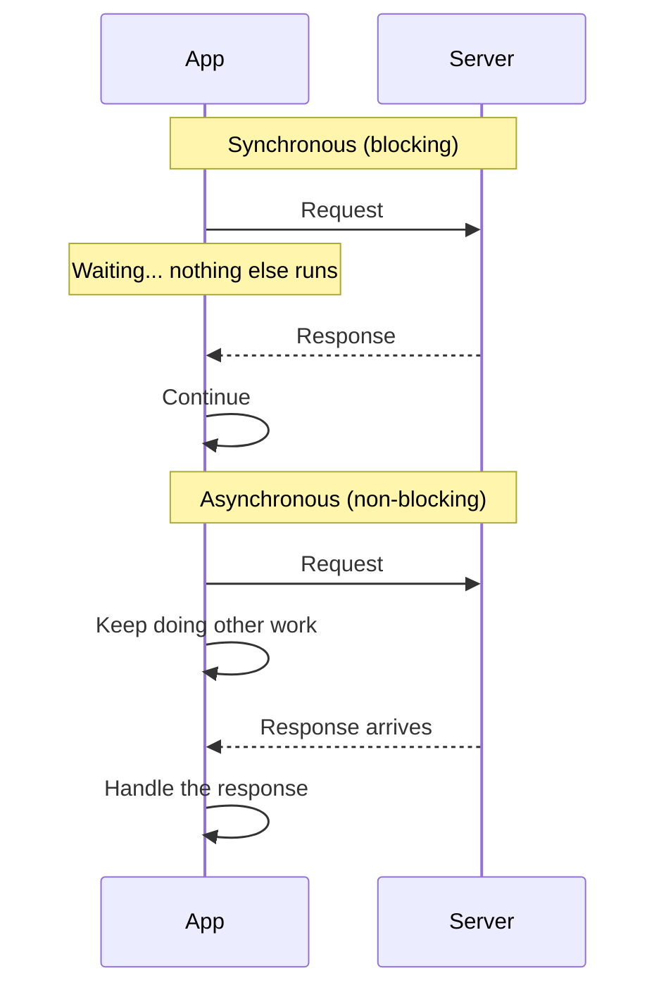
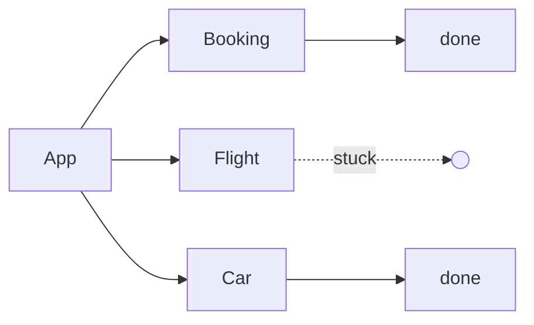

# Synchronous and asynchronous REST clients

> [!summary] In one sentence
> A **synchronous** client stops and waits for the response. An **asynchronous** client keeps working while it waits.

## Side by side

## Comparison

| | **Synchronous** | **Asynchronous** |
|---|---|---|
| While waiting | Everything else is paused | Other parts of the app keep running |
| Behaviour | Blocking | Non-blocking |
| Best when | The response is quick and almost always available | Responses may be slow or unreliable, or you make several requests |
| Risk | One slow request freezes the app | More complex to write |

## Synchronous

> [!success] Good when
> The response is fast and reliably available. The client has to await the response before anything else can run, so this only works well if that wait is short.

## Asynchronous

> [!example] Travel booking
> You send three requests at once:
> 1. Book a hotel
> 2. Schedule a flight
> 3. Rent a car
>
> If one of them gets stuck, the other two can still finish their jobs.

> [!tip] Memory trick
> Sync = standing in line at the counter until your order is ready.
> Async = ordering, getting a buzzer, and sitting down until it goes off.

## Related
- [[URI and URL]]
