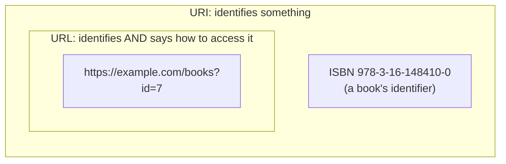

# URI and URL

> [!summary] In one sentence
> Every URL is a URI, but not every URI is a URL. A **URI** *names* a thing. A **URL** *names it and tells you how to reach it*.

## The big picture



The URL circle sits *inside* the URI circle.

## Comparison

| | **URI** | **URL** |
|---|---|---|
| Stands for | Uniform Resource **Identifier** | Uniform Resource **Locator** |
| Purpose | Identifies that something exists | Identifies it **and** tells you where/how to get it |
| Gives access info? | No | Yes |
| Relationship | The broader category | A *type* of URI |
| Example | A book's ISBN | `https://example.com/books?id=7` |

## Anatomy of a URL

```text
https://example.com/books?id=7
└─┬──┘   └───┬─────┘└──┬─┘ └─┬─┘
protocol   host     path  query
```

- **Protocol** (`https`): how to talk to the server.
- **Host** (`example.com`): where the server is. It's a readable stand-in for the IP address.
- **Path** (`/books`): where on the server the thing lives.
- **Query** (`?id=7`): extra details for the request.

## URIs that are not URLs

> [!example] The book analogy
> A book has an identification number that separates it from every other book in the world. That number is a **URI**: it identifies the book, but it doesn't tell you where to find a copy. It's not on the internet and gives no route to access it.
>
> A web address is a **URL**: it identifies the resource *and* gives you the route (protocol + server + path) to reach it.

> [!tip] Memory trick
> - URI = **I**dentifier → "who are you?"
> - URL = **L**ocator → "where do I find you?"

## Related
- [[Synchronous and asynchronous REST clients]]
